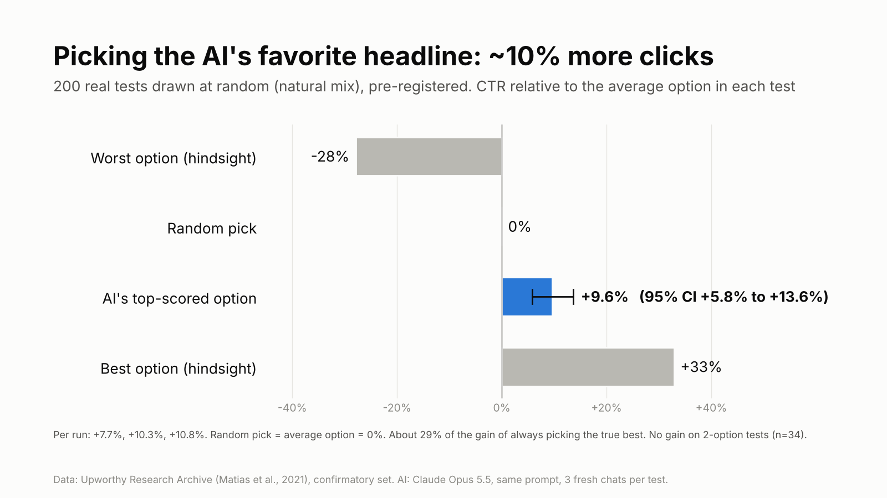
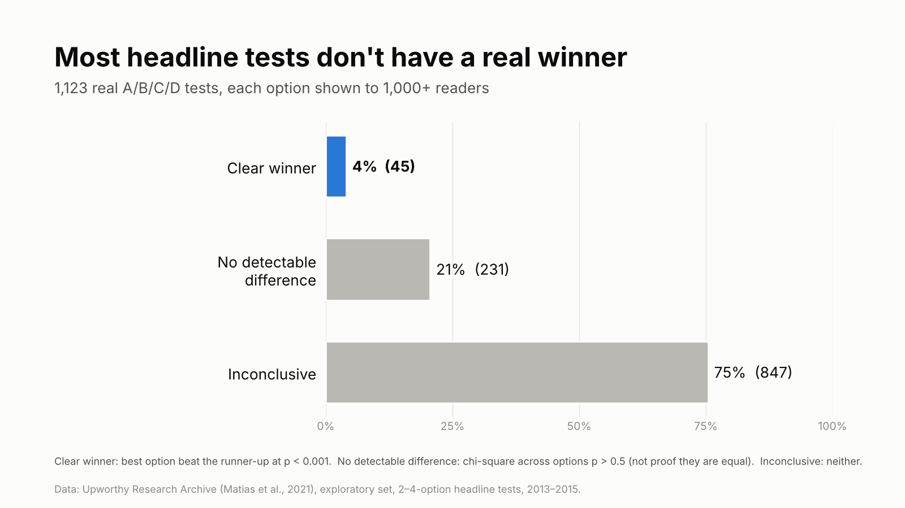
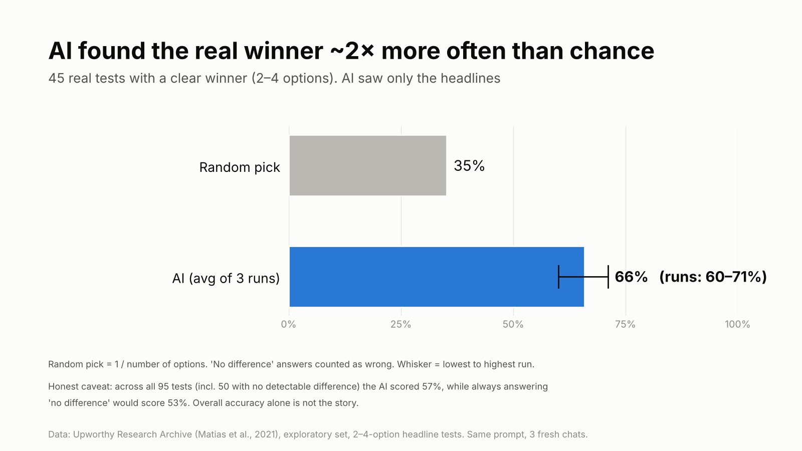
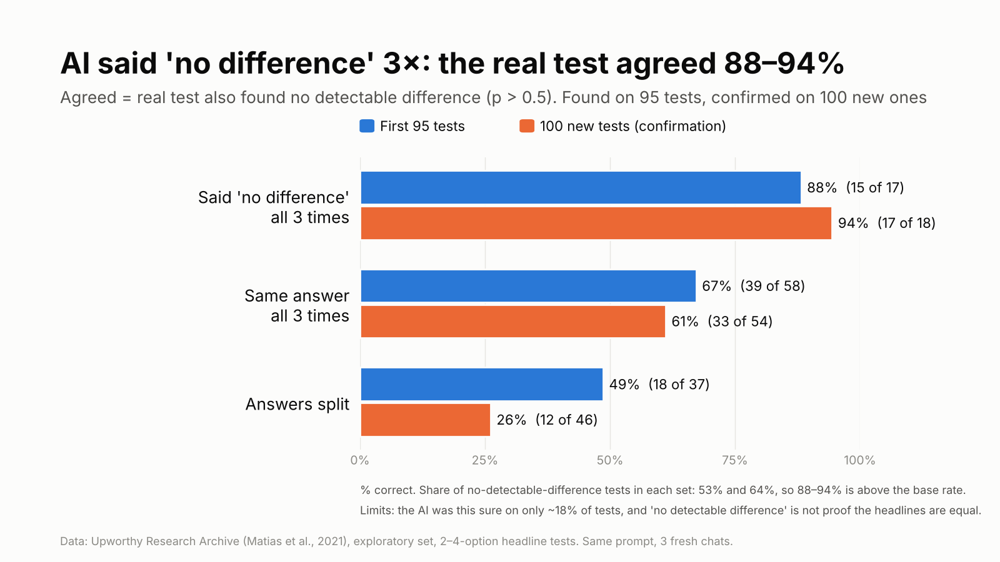

# Can AI predict A/B test winners? A benchmark on real headline tests

I tested whether an AI model can tell, **before a test is run**, which headline will win a real A/B/C/D test, or whether the test will find no difference at all.
Everything here (test sets, prompts, raw AI answers, scripts) is public so anyone can check or rerun it.

- Data: [Upworthy Research Archive](https://upworthy.natematias.com/) (Matias, Munger, Aubin Le Quere & Ebersole, 2021), exploratory set
- AI: Claude Opus 5.5 (claude.ai chat), same prompt in 3 separate fresh chats, no web search
- Status: first results (Nov 2) **plus a pre-registered holdout test on 200 new tests with the natural mix of outcomes (Nov 13)**. The holdout changed the conclusion; read it first.

## Update, Nov 13: pre-registered holdout test (natural mix)

The first results used a quiz that over-represented clear winners. So I ran a second test that was fixed in advance: plan, metrics, analysis code and answer-key hashes were committed **before** any AI run ([PREREGISTRATION.md](PREREGISTRATION.md)). 200 tests were drawn at random from the archive's untouched confirmatory set: 7 clear winners, 32 no detectable difference, 161 inconclusive. Same model, same prompt, 3 fresh chats per test. The answer keys are now in [`holdout_key/`](holdout_key) and match the pre-registered hashes. Full output: [`results/holdout_summary.txt`](results/holdout_summary.txt).

**1. The "skip this test" signal did not replicate. ❌** In the first round, when the AI said "no difference" 3 times in a row, the real test also found no difference 88–94% of the time. On the natural mix it flagged 35 tests, and only 6 of them (17%, 95% CI 8–33%) had no detectable difference, which is *no better* than the 20% base rate (pre-registered H1: p = 0.73). Most flagged tests (28/35) were simply inconclusive. The earlier number came from a quiz that contained only clear winners and no-difference tests, which made the signal look stronger than it is. **I withdraw that claim.**

**2. Picking the AI's favorite headline works. ✅**



Across all 200 tests, the option the AI scored highest got **+9.6% more clicks than the average option** (bootstrap 95% CI +5.8% to +13.6%; per run +7.7%, +10.3%, +10.8%). For scale, the true best option was +32.9% and the worst −27.9%, so the AI captures roughly 29% of the possible gain. The AI's pick was above average in 62% of tests. This was a pre-registered secondary metric.

**3. Picking clear winners: too few to tell.** On the 7 clear-winner tests the AI chose the true best option 43% of the time on average (runs: 57%, 43%, 29%) vs 36% for a random pick.

Other pre-registered numbers: none of the 200 tests was equivalent within ±20% (TOST), as predicted in the pre-registration; the AI gave the same answer in all 3 runs on 121/200 tests; "TIE" answers per run were 50, 45 and 74.

Exploratory, not pre-registered: the lift was +11.9% on 4-option tests (n=151), +8.8% on 3-option tests (n=15) and 0.0% on 2-option tests (n=34). Averaging the 3 runs' scores before picking gave +9.8%, about the same as a single run.

**What this means in practice:** an AI is not a reliable judge of *whether* a test is worth running, but when you have to pick one headline without testing (low traffic, a one-shot launch), letting it rank your options is better than guessing, by about 10% in clicks on this data.

## First results (Nov 2, quiz of 95 tests)

### Key results



**1. Most headline tests don't produce a winner.** Of 1,123 tests with 2–4 headline options (each shown to 1,000+ readers), only **4%** had a clear winner. 21% showed no detectable difference and 75% were inconclusive.



**2. On tests with a real winner, the AI found it 66% of the time** (3 runs: 60–71%), against 35% for a random pick.

**3. Overall accuracy alone is not impressive.** Across all 95 quiz tests the AI scored 57%, but always answering "no difference" would score 53%.



**4. Consistency across runs looked like a useful confidence signal (did not replicate on the natural mix, see the update above).** When the AI said "no difference" in all 3 chats, the real test also found **no detectable difference 88% of the time (15/17)**. On 100 different tests, used only to confirm this, it was **94% (17/18)**. When its answers disagreed across chats, it was right only 26–49% of the time.

The practical reading: **"at this traffic, this test probably won't produce a detectable winner."** It does **not** mean the headlines perform the same (see [Definitions](#definitions-and-an-important-correction)).

## Definitions and an important correction

| Label | Rule |
|---|---|
| Clear winner | Best option's CTR beats the runner-up's, two-proportion z-test p < 0.001 (strict, because picking the best of several arms inflates false winners) |
| No detectable difference | Chi-square test of equal CTR across all options, p > 0.5 |
| Inconclusive | Neither of the above |

Other rules: tests from June 2013 to January 2014 are excluded (the archive documentation warns randomization may be invalid then); within a test, only options with the test's most common image are kept, so only the headline varies; each option needs 1,000+ impressions; option order is shuffled for every question.

**Correction (thanks to a Reddit commenter):** I first called the p > 0.5 group "no real difference". That was wrong. A non-significant result is not evidence of equivalence, and these tests are mostly underpowered:

| "No detectable difference" tests | Quiz (50) | Confirmation set (64) |
|---|---|---|
| Median CTR | 1.1% | 1.1% |
| Median CTR gap, best vs worst option | 0.16pp | 0.19pp |
| Median 95% CI half-width of that gap | ±0.49pp | ±0.50pp |
| Median upper bound, 90% CI of relative lift | +78% | +83% |
| Equivalent within ±30% relative (TOST) | 0 / 50 | 4 / 64 |
| Equivalent within ±50% relative (TOST) | 11 / 50 | 13 / 64 |

So the claim in result 4 is about *detectability at this traffic level*, not about headlines being equal.

## All numbers

From `python scripts/analyze.py` (full output in [`results/summary.txt`](results/summary.txt)).

| | Run 1 | Run 2 | Run 3 | Mean |
|---|---|---|---|---|
| All 95 quiz tests | 60.0% | 51.6% | 60.0% | 57.2% |
| 45 clear-winner tests | 66.7% | 71.1% | 60.0% | 65.9% |
| 50 no-detectable-difference tests | 54.0% | 34.0% | 60.0% | 49.3% |
| Times the AI answered "TIE" | 35 | 20 | 42 | 32 |

Baselines: random answer (any option or TIE) 25.9%; always "TIE" 52.6%; random pick on clear-winner tests 35.2%.

Consistency (same answer in all 3 runs vs answers split):

| | Quiz 95 (where it was found) | Confirmation 100 |
|---|---|---|
| Same answer 3/3 → correct | 39/58 (67%) | 33/54 (61%) |
| Split → majority correct | 18/37 (49%) | 12/46 (26%) |
| Fisher exact, same > split | p = 0.056 | p = 0.0004 |
| "No difference" 3/3 → real test also found none | 15/17 (88%) | 17/18 (94%) |
| Same letter 3/3 → correct | 24/41 (59%) | 16/36 (44%) |
| Share of no-detectable-difference tests in the set | 53% | 64% |

The confirmation set is 100 tests that share no test and no article with the quiz: all 36 remaining winners at p < 0.01 (a looser rule, since all p < 0.001 winners were used in the quiz) plus 64 no-detectable-difference tests.

### What didn't help

- **30 solved example tests in the prompt:** 56.8% vs 60.0% without them on the same run (only-baseline correct 9, only-examples correct 6, McNemar p = 0.61).
- **Calling ties from the AI's score gap:** tuned on the confirmation set, balanced accuracy stayed flat at 50–56% for every threshold. The best threshold lowered quiz accuracy from 60.0% to 53.7%.
- **Majority vote over 3 runs:** 60.0%, no real gain over a single run.

### Memorization check

The archive has been public since 2021, so the model may have seen it. Given the first half of 30 quiz headlines, it said it recognized none, reproduced **0** exactly, and the mean word-sequence similarity to the true endings was 0.13. This rules out verbatim memorization of headlines, but not memory of which option won.

## Limits

- Small samples (95 + 100 tests) and one model.
- 2013–2015 US viral-news headlines; results may not transfer to ads, emails or other audiences.
- The AI was confident enough to say "no difference" 3/3 times on only ~18% of tests, and it misses most no-detectable-difference tests.
- The first quiz over-represented clear winners (45/95) compared with reality (4%); the holdout test fixes this.

## Next

1. ~~Natural-mix confirmatory test~~ done, see the update at the top.
2. **Leaderboard:** run other AI models and synthetic-audience tools on the same 200 holdout tests, scored by the CTR lift of their top pick.
3. **One-shot launches:** test whether ranking options this way helps where A/B testing is impossible (e.g. crowdfunding campaign pages).

## Repository

```
data/       test sets built from the archive (*_blind.csv is what the AI saw; *_answer_key.csv are the answers)
holdout_key/  answer keys of the holdout test, published after all runs (hashes in PREREGISTRATION.md)
prompts/    the exact prompts used
results/    raw AI answers (CSV, as returned) and summary.txt
scripts/    build_sets.py, analyze.py, build_holdout.py, analyze_holdout.py, charts.py
charts/     the three charts
```

### Reproduce

```bash
pip install -r requirements.txt
# download upworthy-archive-exploratory-packages-03.12.2020.csv from https://osf.io/jd64p/
python scripts/build_sets.py path/to/upworthy-archive-exploratory-packages-03.12.2020.csv   # rebuilds data/ and prompts/ (fixed seeds)
python scripts/analyze.py                                                                  # recomputes every number above
python scripts/charts.py
# holdout test: download the confirmatory packages CSV from the same OSF page
python scripts/build_holdout.py path/to/upworthy-archive-confirmatory-packages-03.12.2020.csv
python scripts/analyze_holdout.py
```

To test another model: give it `prompts/1_baseline.txt` with `data/quiz_95_blind.csv` attached in 3 fresh chats, save each CSV answer in `results/`, and add the file names to `analyze.py`.

## Credits and license

- Data: The Upworthy Research Archive, J. Nathan Matias, Kevin Munger, Marianne Aubin Le Quere, Charles Ebersole. *The Upworthy Research Archive, a time series of 32,487 experiments in U.S. media.* Scientific Data (2021). https://doi.org/10.1038/s41597-021-00934-7. Released under CC BY 4.0. Files in `data/` are derived from it and are shared under the same license.
- Code in `scripts/`: MIT License (see `LICENSE`).

Feedback and corrections are welcome. Open an issue.
